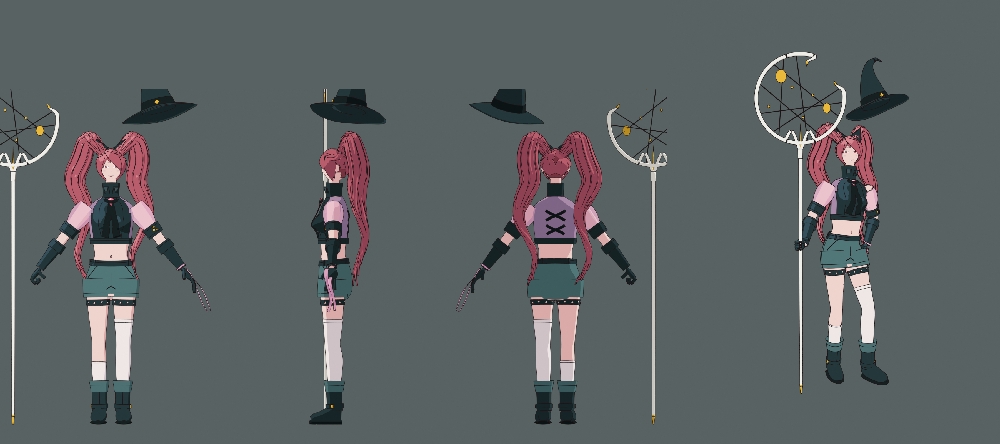
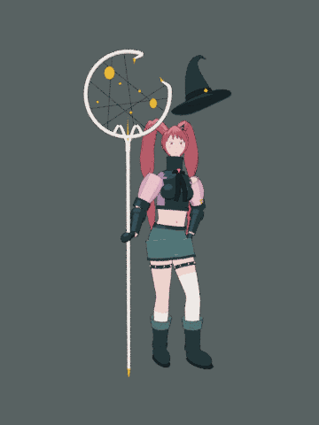

# Rigged witch character (Blender)

A stylized, cel-shaded 3D anime witch modeled after a character reference sheet: twin tails with cat-ear bows, a cropped high-collar jacket with translucent puff sleeves, shorts, mismatched socks, boots, a crescent constellation staff and a floating witch hat.



| File | What it is |
|---|---|
| `witch_character.blend` | The rigged, posed and animated character (face texture packed in) |
| `witch_character.glb` | glTF export for game engines (flat colors, no ink lines) |
| `build_witch.py` | The script that generates everything from scratch |
| `renders/` | Hero render, face close-up, front/side/back turnaround, character sheet, idle animation GIF |

## Rig

- 36 bones: `root`, `hips`, `spine`, `chest`, `neck`, `head`, arms (`upper_arm`, `forearm`, `hand`), legs (`thigh`, `shin`, `foot`), `breast.L/R`, seven-bone chains for each ponytail (`tail.L.0-6`, `tail.R.0-6`), plus `staff` and `hat` prop bones
- Every mesh is skinned with vertex groups, so you can pose it straight away. To put the hat on her head, move the `hat` bone.
- The rest pose is an A-pose (switch the armature to Rest Position to see it). The default pose matches the reference: the staff is planted in her right hand and her left hand rests on her hip.

## Physics

The ponytails and the chest are simulated as damped springs: a verlet chain for each tail and a spring mass for each breast. The simulation is baked into the 96-frame `Idle_Jiggle` action, so the motion plays back anywhere, including in the GLB. To change how bouncy it is, edit the spring constants in `pose_frame()` and rerun the build.



## Modeling

- The body and garments are lofted from elliptical cross-sections. The bust is sculpted into the torso and the jacket, not added as separate shapes.
- Hair is built from flat, lens-shaped clumps: the crown flows from a side part into each tail, the bangs sweep across the forehead, and each ponytail is a wavy mass around a solid core.
- The gloved hands have jointed fingers: a fist around the staff and a relaxed hand on the hip.
- Garment details: princess seams, back lacing, a stand collar with folded flaps, a necktie lying over the bust, belt loops, pocket and fly seams, garters with triangle cut-outs, buckled boots, gold charms, and a translucent ribbon on her left wrist.
- The face has a modeled nose and a painted texture (`textures/face.png`).

## Shading and lines

The materials are emission-only toon shaders: N·L picks two or three flat tones through a constant color ramp, so no lights are needed. The ink lines come from Freestyle, which draws silhouettes, creases, material borders and the seams marked on the garments. Both work in Cycles and EEVEE.

## Rebuilding

```bash
blender --background --python blender/build_witch.py -- --glb
# or, with the bpy module from PyPI (Python 3.13):
pip install bpy pillow
python blender/build_witch.py --glb
```

Add `--quick` for fast low-sample renders, or `--no-render` to only write the `.blend`. Pillow is required, because it paints the face texture.
